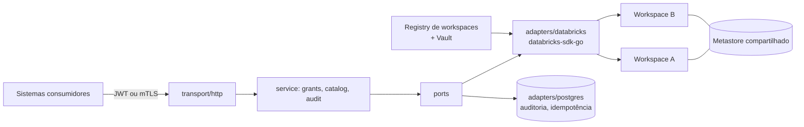

# ADR-0001: Arquitetura do serviço de governança de dados sobre o Databricks

| Campo | Valor |
|---|---|
| **Status** | Proposta |
| **Data** | 2026-11-03 |
| **Decisores** | _a preencher_ |
| **Escopo** | Microserviço backend interno, em Go, que intermedeia sistemas da plataforma de governança e a API de workspace do Databricks (Unity Catalog) |
| **Artefatos relacionados** | `openapi.yaml` v0.1.0 (contrato OpenAPI 3.1) e `gen_openapi.py` (gerador do contrato) |

---

## 1. Contexto

A plataforma de governança de dados precisa gerir acessos a catálogos, schemas e tabelas em workspaces do Databricks, com operações de `GRANT` e `REVOKE`. O mesmo serviço também deve cobrir tarefas administrativas, como criação de schemas e tabelas.

Os sistemas internos não devem falar diretamente com a API do Databricks. Isso espalharia credenciais, duplicaria regras de negócio e deixaria a organização sem trilha de auditoria centralizada.

Fatos do ambiente que moldam as decisões:

- O serviço atenderá **vários workspaces**.
- O Unity Catalog é organizado **por metastore**, não por workspace. Workspaces ligados ao mesmo metastore enxergam os mesmos objetos.
- A API nativa de permissões é um `PATCH` com lista de mudanças (`add`/`remove`) por principal, e não tem noção de motivo, ticket ou auditoria própria.
- Parte do DDL (por exemplo, criação de tabelas gerenciadas) não tem endpoint REST equivalente estável e passa pela SQL Statement Execution API, que é assíncrona.

## 2. Forças (drivers de decisão)

1. **Desacoplamento:** consumidores não podem depender de peculiaridades nem de mudanças da API do Databricks.
2. **Rastreabilidade:** toda mudança de acesso precisa de motivo, autor, estado anterior e posterior.
3. **Segurança:** menor privilégio, credenciais isoladas por workspace, nenhum SQL arbitrário exposto.
4. **Segurança operacional:** evitar que uma operação de governança remova o acesso do próprio serviço (lockout).
5. **Compatibilidade com ferramental:** proxies, API gateways e geradores de cliente OpenAPI devem funcionar sem exceções.
6. **Evolução incremental:** entregar governança primeiro e deixar operações assíncronas e declarativas para depois.
7. **Testabilidade:** a regra de domínio deve ser testável sem o Databricks.

## 3. Decisões

### D1. O serviço é uma API de domínio, não um proxy

**Decisão:** expor um modelo próprio de governança (grants, catálogo, principals, auditoria) que mapeia para a API do Databricks, em vez de replicar os endpoints 1:1.

**Alternativas consideradas**
- *Proxy transparente* da API do Databricks: simples, mas acopla os consumidores às mudanças e não permite regras de negócio, auditoria nem política de autorização.
- *Cada sistema usa o SDK diretamente:* espalha credenciais e regras.

**Justificativa:** o valor do serviço está justamente nas regras que o Databricks não impõe: motivo obrigatório, matriz de privilégios, principals protegidos, autorização por catálogo e auditoria.

**Consequências:** há um custo de manutenção para acompanhar a API do Databricks, mitigado pelo uso do SDK oficial (D2).

### D2. Go com o SDK oficial e arquitetura hexagonal (ports/adapters)

**Decisão:** implementar em Go sobre `databricks-sdk-go`, isolando o SDK em `adapters/databricks`. A camada de serviço depende apenas de interfaces pequenas, por capacidade, em `ports` (por exemplo `GrantsAPI`, `CatalogsAPI`, `IdentityAPI`, `AuditStore`), e não de um `DatabricksClient` gigante.

```
cmd/api
internal/
  transport/http       handlers, DTOs, middlewares
  service/             grants, catalog, audit
  domain/              securable, privilege (matriz), principal, erros
  ports/               interfaces
  adapters/databricks  databricks-sdk-go
  adapters/postgres    auditoria, idempotência
```

**Justificativa:** o SDK cobre as APIs necessárias (Grants, Catalogs, Schemas, Tables, Volumes, Entity Tag Assignments, ABAC Policies, Request for Access, Workspace Bindings, Statement Execution, Warehouses, IAM) e é mantido pelo fabricante. Interfaces pequenas tornam os mocks triviais e permitem trocar a implementação.

**Consequências:** o domínio não importa o SDK. A versão do SDK deve ser fixada, e as mudanças de API absorvidas apenas no adapter.

### D3. REST orientado a recursos, versionado em `/v1`, com sub-recursos em vez de *custom methods*

**Decisão:** ações que não são CRUD usam sub-recursos com `POST` (`/grants/grant`, `/grants/revoke`, `/grants/batch`, `/operations/{id}/cancel`), e não o estilo `:verbo` (`grants:grant`).

**Alternativas consideradas**
- *Custom methods* (`/grants:batch`): válido pela RFC 3986 e usado por APIs do Google, mas alguns roteadores (gin, echo), gateways e geradores de cliente OpenAPI tratam `:` de forma especial ou mal.
- *Recurso substantivo* (`/grant-batches`): mais "puro", porém cria recursos artificiais para ações pontuais.

**Justificativa:** menor atrito com ferramental, ao custo de alguma elegância semântica. Mantém o vocabulário do domínio (`grant`/`revoke`, o mesmo do SQL) em vez de `add`/`remove`.

### D4. Hierarquia explícita na URL, sem `full_name` com pontos

**Decisão:** `/catalogs/{catalog}/schemas/{schema}/tables/{table}`, em vez de um único parâmetro com o nome completo e pontos. Em OpenAPI, um path parameter não pode conter `/`, e o parâmetro único também é ambíguo em relação a encoding.

**Alternativa considerada:** rotas planas com `full_name`, como no Unity Catalog OSS (`/schemas/{full_name}`, `/permissions/{securable_type}/{full_name}`). É a convenção do upstream, mas ambígua e menos tipada em clientes gerados.

**Consequências:** o número de rotas cresce (cinco tipos de securable × sete sub-recursos). Isso é resolvido gerando o contrato por script (D11). Os nomes em path aceitam qualquer nome existente, sem `.`, `/` ou espaço. A criação exige o padrão `^[a-z][a-z0-9_]{0,254}$`.

### D5. Multi-workspace: alias no path e registry interno

**Decisão:** todas as rotas de recurso ficam sob `/v1/workspaces/{ws}`, onde `{ws}` é um **alias do registry** do serviço (por exemplo `prod-br`), não o ID numérico do Databricks. O registry resolve host, metastore e credenciais, e é somente leitura via API (`GET /v1/workspaces[/{ws}]`).

**Consequências**
- Os consumidores não conhecem hosts nem IDs.
- Como o metastore é compartilhado, um grant via `ws-a` vale também em `ws-b`. Por isso eventos de auditoria e `SecurableRef` carregam `metastore_id`, e a auditoria é **global** (`/v1/audit/events`, com filtro `workspace`).
- Catálogos podem não estar vinculados ao workspace usado, o que gera `409` (workspace bindings).
- A chave de idempotência tem escopo (workspace + chamador + chave), e os principals protegidos são definidos por workspace.

### D6. Credenciais do Databricks: OAuth M2M por workspace, em cofre de segredos

**Decisão:** um service principal por workspace, autenticado por OAuth M2M, com o segredo em Vault ou Secret Manager. Esse principal precisa ser dono dos objetos ou ter `MANAGE`.

**Justificativa:** isola o impacto de um vazamento a um workspace e permite rotação independente. Tokens pessoais (PAT) foram descartados por não terem rotação automática nem identidade de serviço.

### D7. Modelo de grants: fachada `grant`/`revoke` primeiro, declarativo (`plan`/`sync`) depois

**Decisão:**
1. **Fase 1:** `POST .../grants/grant` e `.../grants/revoke` sobre cada securable, com validação, auditoria e idempotência (revogar privilégio inexistente retorna 200 com `changed: false`).
2. **Fase seguinte:** `/grants/plan` (dry-run), `/grants/sync` e `/grants/batch`.
3. O `sync` terá `mode` explícito, espelhando os dois modelos do Terraform: `authoritative_securable` (como `databricks_grants`, substitui tudo), `authoritative_principal` (como `databricks_grant`, só um principal) e `additive`. Começa pelos dois últimos, que são mais seguros.

**Regras de domínio obrigatórias**
- **Principals protegidos:** o service principal do serviço nunca pode perder `MANAGE`, nem num revoke explícito nem num sync autoritativo. A documentação do Pulumi/Terraform alerta que, se a identidade com `MANAGE` não estiver na lista, seus privilégios são removidos.
- **Matriz de privilégios por tipo de objeto**, validada antes de chamar o Databricks (422 `privilege-not-applicable`).
- **Validação de existência do principal** antes do grant (422 `principal-not-found`).
- **`X-Change-Ref` obrigatório** em toda escrita.
- **Autorização própria do serviço:** quem pode conceder o quê, em qual catálogo, independentemente do que o service principal pode fazer no Databricks.

**Status desta decisão:** a parte imperativa está **aceita para implementação**. O modo declarativo é **proposto** e depende de confirmação (ver seção 8).

### D8. DDL de tabelas e views via SQL Statement Execution, assíncrono (fase 2)

**Decisão:** a criação de tabelas e views será feita gerando DDL a partir de templates, com validação rigorosa de identificadores, executado pela SQL Statement Execution API. A resposta é `202 Accepted` com `operation_id`, consultável em `/operations/{id}`, com cancelamento. Não existirá endpoint de SQL arbitrário: apenas allowlist de tipos de statement.

**Alternativa considerada:** a Unity REST API permite que clientes Delta externos criem tabelas gerenciadas, mas está em Public Preview e exige tabelas com *catalog commits*. Fica como possibilidade futura.

**Consequências:** a infraestrutura de operações (tabela `operations`, polling, cancelamento) só entra na fase 2. Por isso a fase 1 expõe tabelas e views apenas para leitura e `DELETE`.

### D9. Convenções transversais de API

| Tema | Decisão |
|---|---|
| Erros | RFC 9457 (`application/problem+json`), com campo `upstream` para o erro original do Databricks e mapeamento para 400/401/403/404/409/422/429/5xx |
| Idempotência | Header `Idempotency-Key`: obrigatório em criações (DDL não é idempotente), opcional em grant/revoke |
| Motivo da mudança | Header `X-Change-Ref` obrigatório em toda escrita (em header, porque `DELETE` com corpo é desencorajado) |
| Paginação | Cursor (`page_size`, `page_token`, `next_page_token`), como na API do Databricks |
| Correlação | `X-Request-Id` aceito ou gerado, devolvido e propagado às chamadas ao Databricks |
| `DELETE` | Exige `?confirm=<nome completo>` e respeita lista de objetos protegidos; `force` só para catálogo e schema |
| Rate limit | Backoff com jitter e respeito a `Retry-After` nas chamadas ao Databricks (429); o serviço devolve `Retry-After` quando aplicável |
| Autenticação interna | JWT (OIDC) ou mTLS entre serviços |

### D10. Auditoria própria e persistência em Postgres

**Decisão:** toda mutação grava um evento (`workspace`, `metastore_id`, autor, ação, objeto, principals-alvo, `change_ref`, `request_id`, estado anterior e posterior, resultado). O armazenamento é Postgres, que também guarda as chaves de idempotência (retenção de 24 h) e, na fase 2, as operações assíncronas.

**Justificativa:** a auditoria nativa do Databricks não carrega o motivo nem o ticket da mudança, e o serviço precisa responder "quem mudou o quê, por quê" entre workspaces.

### D11. Contrato primeiro, em OpenAPI 3.1 gerado por script

**Decisão:** o contrato (`openapi.yaml`) é a fonte de verdade da API. Ele é gerado por `gen_openapi.py`, porque os sub-recursos de governança se repetem para cada tipo de securable, e a geração garante consistência. As structs Go e as interfaces de servidor devem ser geradas a partir dele (por exemplo com `oapi-codegen`; a escolha da ferramenta ainda está **em aberto**).

**Consequências:** mudanças de API passam pelo script e pela validação do contrato em CI (por exemplo `openapi-spec-validator`), nunca por edição manual do YAML.

### D12. Escopo faseado

| Fase | Conteúdo |
|---|---|
| **1A** | Workspaces (registry, leitura), principals (leitura), auditoria, grants (list, effective, grant, revoke) |
| **1B** | CRUD de catalogs, schemas e volumes; tables e views (leitura e `DELETE`); owner; tags |
| **1C** | `grants/batch`, `grants/plan`, `grants/sync` |
| **2** | Criação de tabelas e views (SQL assíncrono, `/operations`), external locations, storage credentials, connections, warehouses (start/stop) |
| **3** | ABAC, tag policies (governed tags), pedidos de acesso (RFA), workspace bindings, ACLs de objetos de workspace, gestão de grupos |

## 4. Visão geral



## 5. Alternativas globais descartadas

| Alternativa | Motivo da rejeição |
|---|---|
| Consumidores usando o SDK ou Terraform diretamente | Sem auditoria centralizada, sem regras de negócio, credenciais espalhadas |
| Terraform como único mecanismo | Bom para estado declarativo, mas não atende pedidos pontuais sob demanda nem retorna resultado síncrono a sistemas |
| Proxy 1:1 da API do Databricks | Acoplamento e ausência de políticas próprias (D1) |
| Endpoint genérico de SQL | Superfície de ataque e quebra de governança |

Não foi encontrado projeto open source em Go que atue como gateway de governança sobre o Databricks. As referências usadas foram o SDK oficial, o provider Terraform/Pulumi, o plugin Kestra de Unity Catalog, os servidores MCP do Databricks e o Unity Catalog OSS.

## 6. Consequências

### Positivas
- Ponto único de controle e auditoria para mudanças de acesso, entre workspaces.
- Consumidores desacoplados do Databricks e com contrato tipado e versionado.
- Regras de domínio (matriz de privilégios, principals protegidos, confirmação de delete) testáveis sem o Databricks.
- Entrega incremental: a fase 1 já entrega valor sem depender de operações assíncronas.

### Negativas e custos
- Novo serviço crítico para operar (disponibilidade, observabilidade, rotação de credenciais).
- Manutenção do mapeamento domínio → API do Databricks conforme o produto evolui.
- Contrato extenso (52 caminhos, 68 operações na v0.1.0), mitigado pelo gerador.

### Riscos e mitigações

| Risco | Mitigação |
|---|---|
| Lockout do service principal por revoke ou sync autoritativo | Principals protegidos por workspace (D7) |
| Mesmo objeto alterado via workspaces distintos (metastore compartilhado) | `metastore_id` na auditoria; avaliar lock por objeto antes de `sync` |
| Drift: alteração direta no Databricks fora do serviço | Fase futura: `plan`/`sync` e varredura de drift |
| Rate limit do Databricks (429) em lotes | Backoff com jitter, `Retry-After`, limite de concorrência por workspace |
| SQL gerado com identificador malicioso (fase 2) | Templates fixos, validação de identificadores, allowlist de statements |
| Mudanças na API do Databricks | SDK fixado por versão e isolado no adapter |

## 7. Premissas a validar

Estes pontos foram assumidos a partir de conhecimento prévio e não foram confirmados na documentação:

1. A **allowlist de privilégios** e a **matriz de aplicabilidade por tipo de objeto** precisam ser conferidas na referência oficial de privilégios do Unity Catalog.
2. **Views:** assume-se que grants em views usam o tipo `table` na API nativa e que o delete passa pela API de tables. O adapter faria esse mapeamento.
3. **Comentário em tabela:** assume-se que o update de tabelas pela API só altera o dono, e que o comentário exige SQL. Por isso `PATCH` em tables e views ficou fora da fase 1.
4. **Caminhos REST** de Request for Access e tag policies (propostos em `/access-requests` e `/tag-policies`) precisam ser confirmados.
5. **Vínculo catálogo ↔ workspace:** o comportamento exato quando um catálogo não está vinculado ao workspace usado (código e mensagem de erro) precisa ser confirmado para o mapeamento do `409`.

## 8. Questões em aberto

1. **Modelo de grants:** o declarativo (`plan`/`sync`) será o caminho principal, ou apenas complemento ao imperativo? Qual será a fonte do estado desejado (versionado em Git, em banco do próprio serviço)?
2. **Gestão de identidades:** o serviço fica somente leitura (IdP via SCIM como fonte de verdade) ou também gerencia grupos?
3. **Operações de nível de conta** (metastore, atribuição de workspaces) entram no escopo ou ficam só no nível de workspace?
4. **Roteador HTTP:** `net/http` (Go 1.22+) ou `chi`. Com o fim dos *custom methods* (D3), ambos funcionam sem restrições; a escolha é de preferência da equipe.
5. **Gerador de código** a partir do contrato (`oapi-codegen` ou equivalente).
6. **Política de autorização própria:** formato inicial (allowlist por catálogo e por grupo do chamador) e evolução (OPA ou similar).
7. **Retenção** da auditoria e política de acesso a ela.

## 9. Critérios para revisitar esta ADR

- O Databricks passar a oferecer auditoria nativa com motivo e referência de mudança por operação.
- A Unity REST API para criação de tabelas gerenciadas sair de Public Preview (revisitar D8).
- O número de workspaces ou o volume de grants tornar o modelo imperativo inviável (acelera o declarativo).
- Surgir um gateway open source equivalente e mantido.

## 10. Referências

- Databricks, API de permissões do Unity Catalog (`PATCH /api/2.1/unity-catalog/permissions/{securable_type}/{securable_full_name}`): https://docs.databricks.com/api/uc-grants/v1/update-permissions.md
- Databricks SDK para Go, lista de APIs de serviço: https://pkg.go.dev/github.com/databricks/databricks-sdk-go/service
- Terraform provider Databricks, `databricks_grants` e `databricks_grant`: https://github.com/databricks/terraform-provider-databricks/blob/master/docs/resources/grants.md
- Pulumi Databricks, `Grants` (aviso sobre `MANAGE`): https://www.pulumi.com/registry/packages/databricks/api-docs/grants
- Databricks, Entity Tag Assignments: https://docs.databricks.com/api/workspace/entitytagassignments
- Databricks, ABAC GRANT policies: https://docs.databricks.com/aws/en/data-governance/unity-catalog/abac/grant-policies
- Databricks, Unity REST API (criação, leitura e escrita por clientes externos): https://learn.microsoft.com/en-us/Azure/databricks/external-access/unity-rest
- Unity Catalog OSS, cliente da API (rotas planas): https://pypi.org/project/unitycatalog-client-preview/
- Kestra, plugin Unity Catalog Grants Update: https://kestra.io/plugins/plugin-databricks/unity-catalog-grants/io.kestra.plugin.databricks.unitycatalog.grant.update
- Databricks Utils MCP Server (referência de operações de leitura e warehouses): https://pypi.org/project/databricks-utils-mcp/
- Referência de API do workspace: https://docs.databricks.com/api/workspace/

## 11. Histórico

| Data | Alteração |
|---|---|
| 2026-11-03 | Versão inicial (Proposta), consolidando o desenho da fase 1 e o contrato OpenAPI v0.1.0 |
